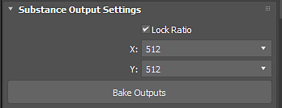
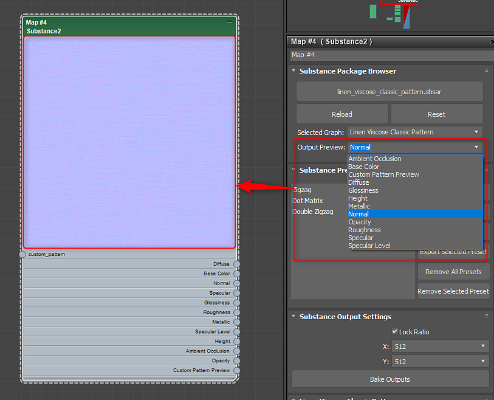

# 3ds Max의 Substance 개요

## 플러그인 개요

## Substance 열기

1. 슬레이트 편집기를 열고 Substance을 검색하고 Substance2 노드를 보기로 드래그합니다.
1. Substance 노드를 두 번 클릭하여 속성을 활성화하고 Substance 패키지 브라우저에서 Substance을 로드합니다.

   >[!NOTE]
   >
   > .sbsar 파일을 [슬레이트 편집기]로 끌어 놓으면 노드가 자동으로 만들어지고 sbar를 가져올 수도 있습니다.

1. Substance에 여러 그래프가 포함된 경우 [선택한 그래프] 드롭다운 메뉴에서 자료로 출력할 그래프를 선택할 수 있습니다.

   

1. Substance 노드가 선택된 상태에서 Substance 메뉴로 이동하여 지원되는 렌더러를 선택합니다. 재질이 만들어지고 개체에 적용될 준비가 됩니다. Substance 텍스처가 렌더링 재질에 후크됩니다.

>[!NOTE]
>
> **&quot;Substance2&quot;** 노드를 선택한 후에는 **로드 Substance...**&#x200B;를 먼저 클릭하여 sbsar 파일을 선택한 다음 상단 메뉴에서 지원되는 렌더러(예: &quot;Arnold로 Substance&quot;)를 선택해야 합니다.
>
>지원 렌더러로는 Arnold, V-Ray, Corona 및 Octane 등이 있습니다. [OpenPBR 재질을 사용하는 방법을 알아보려면 3DS Max의 워크플로우에 대해 알아보세요.](../using-workflows-3ds-max/using-workflows-in-3ds-max.md)

## 해상도 변경

1. [Substance 출력 설정]에서 계산된 Substance 텍스처에 원하는 해상도를 설정합니다.
1. 최대 8K의 해상도에 대해 [Substance 설정](../../../3d-applications/3ds-max/settings-1/substance-settings.md)에 설정된 GPU 엔진을 사용하고 있는지 확인하십시오.

   

## 매개변수 변경

1. Substance 노드를 두 번 클릭하여 매개변수 창에 Substance 매개변수를 로드합니다.
1. 매개 변수를 변경하여 Substance 텍스처를 자동으로 업데이트합니다.

   {width="500px"}

## 출력 미리 보기 설정

Substance 노드의 축소판에 대해 특정 채널을 설정할 수 있습니다.

1. [출력 미리 보기] 드롭다운에서 노드 축소판에 사용할 채널을 선택합니다.

   

## 타일링 Substance

[좌표] 속성을 사용하여 Substance 텍스처를 바둑판식으로 배열하고 [채널 매핑]을 설정할 수 있습니다.

## OpenPBR 작업 과정

**Substance 메뉴**&#x200B;의 **작업 과정 목록**&#x200B;에서 **OpenPBR에 Substance** 및 **V-Ray OpenPBR에 Substance**&#x200B;의 두 가지 OpenPBR 작업 과정을 사용할 수 있습니다. 이러한 워크플로우는 Substance 3D Designer 또는 Sampler에서 OpenPBR 재질 모델을 사용하여 작성된 SBSAR 파일에 사용하도록 설계되었습니다(Designer V16.0+ 및 Sampler V6.0+ 이후 OpenPBR이 기본 모델임).

### OpenPBR 소개

OpenPBR은 Adobe과 오토데스크가 개발하고 ASWF(Academy Software Foundation)에 기여한 개방형 물리적 소재 음영 모델입니다. 렌더러 간에 호환되는 통합된 재질 정의를 제공합니다. 자세한 내용은 [OpenPBR 설명서](https://experienceleague.adobe.com/en/docs/substance-3d/general-knowledge/openpbr/openpbr-overview)를 참조하십시오.

### OpenPBR 워크플로우를 사용하는 경우

Substance 3D Designer 또는 Substance 3D Sampler에서 OpenPBR 재질 모델을 사용하여 SBSAR 파일을 만든 경우 OpenPBR 워크플로를 사용하십시오. SBSAR가 Adobe 표준 재질 모델(ASM)을 사용하여 작성된 경우 렌더러와 호환되는 레거시 워크플로우(Arnold, V-Ray 또는 V-Ray 6)를 사용합니다.

>[!NOTE]
>
> ASM 재료에 OpenPBR 워크플로우를 적용하거나 OpenPBR SBSAR에 표준 워크플로우를 적용하면 플러그인에서는 두 재질 모델에 공통적인 출력만 접속합니다. 결과가 완전하지 않을 수 있습니다.

### 사용 가능한 OpenPBR 워크플로우

**OpenPBR**

네이티브 3ds Max openPBRSurface 노드를 사용합니다. 아놀드, 브이레이와 호환됩니다. 3ds Max에서 OpenPBR 재질을 사용하여 작업하는 대부분의 사용자에게 권장되는 워크플로입니다.

**OpenPBR - V-레이**

OpenPBR 모드에서 V-Ray 재질(VRayMtl)을 사용합니다. 파이프라인이 V-Ray 재질 설정을 중심으로 특별히 제작된 사용자에게 권장됩니다.

### OpenPBR 작업 과정을 적용하는 방법

1. [Substance 불러오기] 단추를 사용하여 SBSAR 파일(OpenPBR)을 선택합니다.
1. 상단 메뉴에서 OpenPBR 또는 OpenPBR - V-Ray 를 선택합니다.
1. 네트워크 생성(Create Network)을 클릭하여 Slate Material Editor에서 셰이더 네트워크를 생성합니다.
1. 플러그인은 SBSAR 출력들을 OpenPBR 노드의 대응하는 입력들에 자동으로 연결한다.
1. 평소와 같이 메시에 재질을 할당합니다.

