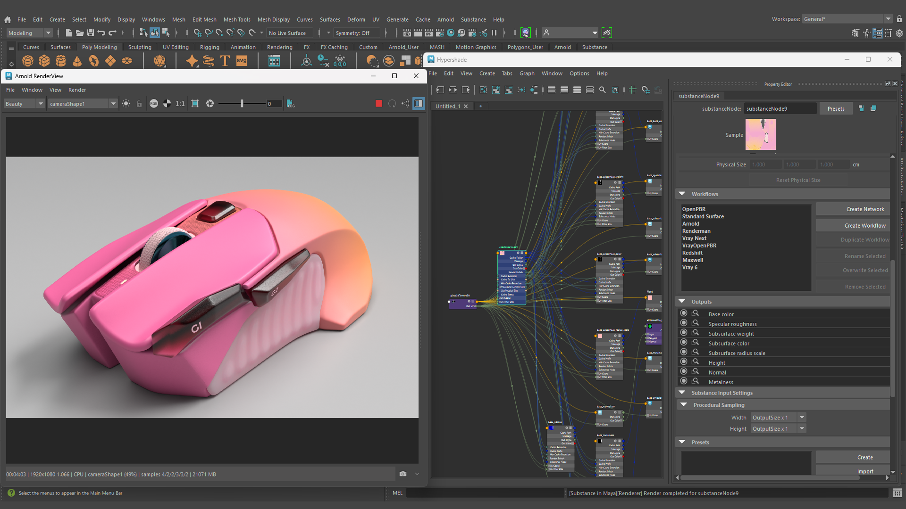

# 워크플로우 사용

[작업 과정]에서 Substance 출력에 대한 렌더링 사전 설정을 선택하거나 만들 수 있습니다. 이러한 사전 설정은 Arnold 또는 Vray 같은 렌더러의 셰이더 네트워크입니다.

>[!NOTE]
>
> **워크플로 사전 설정 위치**
>
> **Windows**:
> C:\Users\\Documents\maya\2022\substance\workflows\generated
> **MacOS**:
> /Users//Library/Preferences/Autodesk/maya//substance/workflows/generated
> **Linux**:
> /home//maya//substance/workflows/generated

워크플로우를 사용하려면 목록에서 사전 설정을 선택한 다음 네트워크 만들기 버튼을 클릭하십시오.

## 워크플로우 만들기

나만의 워크플로우를 만들어 렌더러 워크플로우 목록에 추가할 수 있습니다. 새 워크플로우를 추가하면 Substance 노드 이후에 생성된 모든 노드가 워크플로우에 저장됩니다. 이렇게 하면 원하는 수의 음영 노드를 만들어 사전 설정 워크플로로 저장할 수 있는 완전한 사용자 지정 셰이더 네트워크를 만들 수 있습니다.

## 워크플로우 관리

### 사용자 정의 작업 과정 저장

1. Substance 출력을 수동으로 만들고 aiStandardSurface와 같은 재질에 연결합니다.
   1. Maya나 렌더링 특정 노드를 사용하여 셰이더 네트워크를 만들 수 있습니다.
1. **작업 과정 만들기** 단추를 클릭하고 작업 과정 사전 설정의 이름을 입력합니다.

### 작업 과정 복제

**워크플로 복제** 단추를 클릭하여 워크플로를 복제할 수 있습니다.

### 워크플로우 이름 바꾸기 및 덮어쓰기

**이름 바꾸기** 및 선택한 **덮어쓰기** 단추를 사용하여 기존 작업 과정의 이름을 바꾸고 업데이트된 데이터로 작업 과정을 덮어쓸 수 있습니다.

### 워크플로우 제거

워크플로우 제거 버튼을 사용하여 기존 워크플로우를 제거할 수 있습니다.

## OpenPBR 작업 과정

작업 과정 목록에서 다음 두 가지 OpenPBR 작업 과정을 사용할 수 있습니다. **OpenPBR** 및 **OpenPBR - V-Ray**. 이러한 워크플로우는 Substance 3D Designer 또는 Sampler에서 OpenPBR 재질 모델을 사용하여 작성된 SBSAR 파일에 사용하도록 설계되었습니다(Designer V16.0+ 및 Sampler V6.0+ 이후 OpenPBR이 기본 모델임).

### OpenPBR 소개

OpenPBR은 Adobe과 오토데스크가 개발하고 ASWF(Academy Software Foundation)에 기여한 개방형 물리적 소재 음영 모델입니다. 렌더러 간에 호환되는 통합된 재질 정의를 제공합니다. 자세한 내용은 [OpenPBR 설명서](https://experienceleague.adobe.com/en/docs/substance-3d/general-knowledge/openpbr/openpbr-overview)를 참조하십시오.

### OpenPBR 워크플로우를 사용하는 경우

Substance 3D Designer 또는 Substance 3D Sampler에서 OpenPBR 재질 모델을 사용하여 SBSAR 파일을 만든 경우 OpenPBR 워크플로를 사용하십시오. SBSAR가 Adobe 표준 재질 모델(ASM)을 사용하여 작성된 경우 렌더러와 호환되는 레거시 워크플로우(Arnold, V-Ray 또는 V-Ray 6)를 사용합니다.

>[!NOTE]
>
> ASM 재료에 OpenPBR 워크플로우를 적용하거나 OpenPBR SBSAR에 표준 워크플로우를 적용하면 플러그인에서는 두 재질 모델에 공통적인 출력만 접속합니다. 결과가 완전하지 않을 수 있습니다.

### 사용 가능한 OpenPBR 워크플로우

**OpenPBR**

기본 Maya openPBRSurface 노드를 사용합니다. 아놀드, 브이레이와 호환됩니다. 이 워크플로우는 Maya에서 OpenPBR 재질을 사용하여 작업하는 대부분의 사용자에게 권장되는 워크플로우입니다.

**OpenPBR - V-레이**

OpenPBR 모드에서 V-Ray 재질(VRayMtl)을 사용합니다. 파이프라인이 V-Ray 재질 설정을 중심으로 특별히 제작된 사용자에게 권장됩니다.

### OpenPBR 작업 과정을 적용하는 방법

1. [Substance 불러오기] 단추를 사용하여 SBSAR 파일을 플러그인에 불러옵니다.
1. 작업 과정 목록에서 **OpenPBR** 또는 **OpenPBR - V-레이**&#x200B;를 선택합니다.
1. **네트워크 만들기**&#x200B;를 클릭하여 **Hypershade 재질 편집기**&#x200B;에서 셰이더 네트워크를 만듭니다.
1. 플러그인은 SBSAR 출력들을 OpenPBR 노드의 대응하는 입력들에 자동으로 연결한다.
1. 평소와 같이 메시에 재질을 할당합니다.

